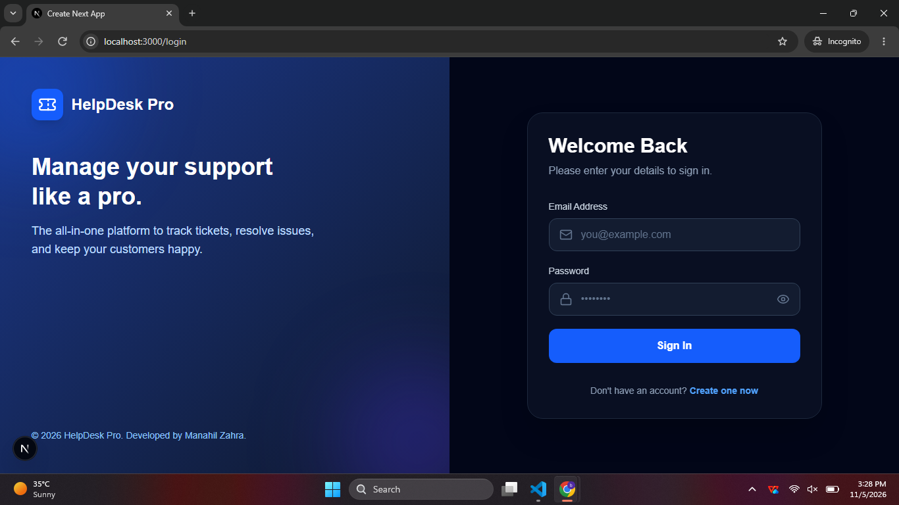
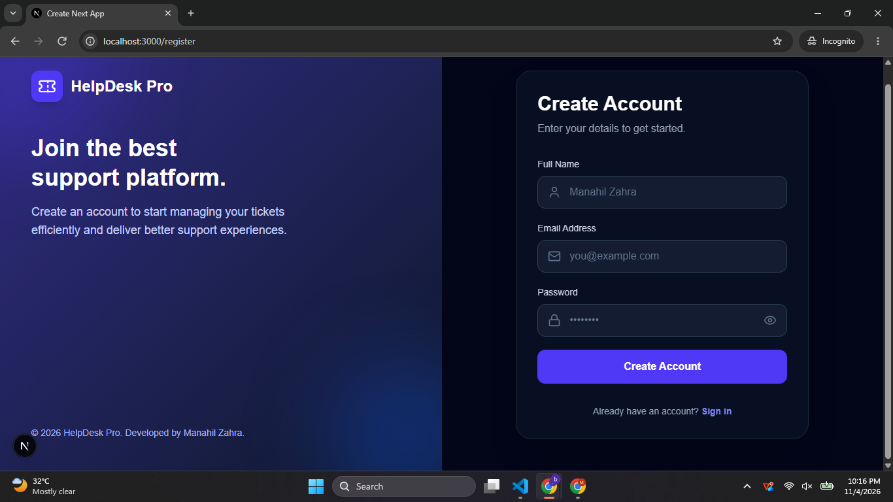
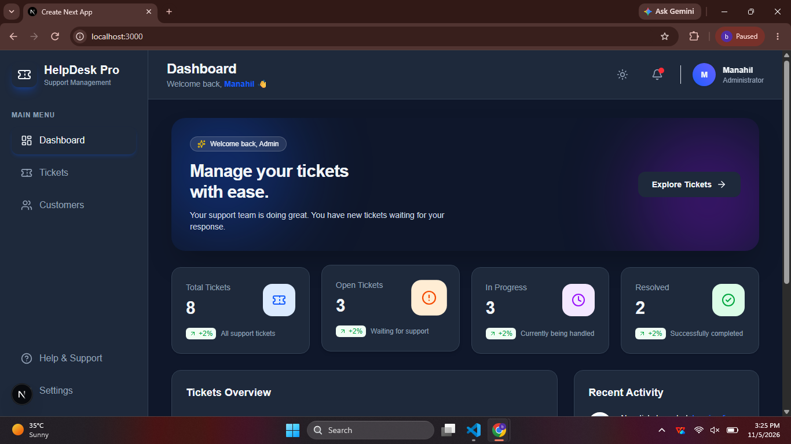
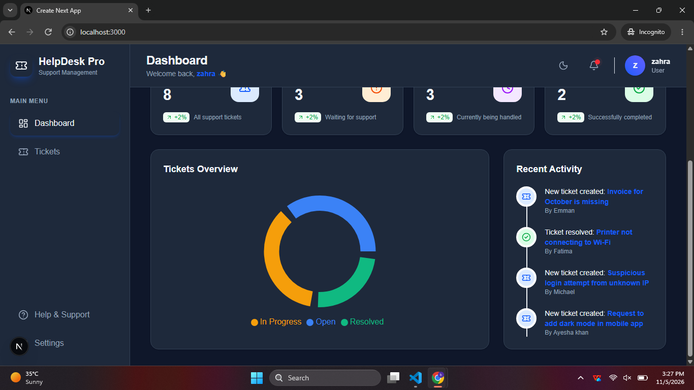
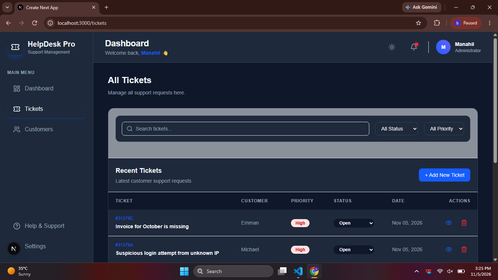
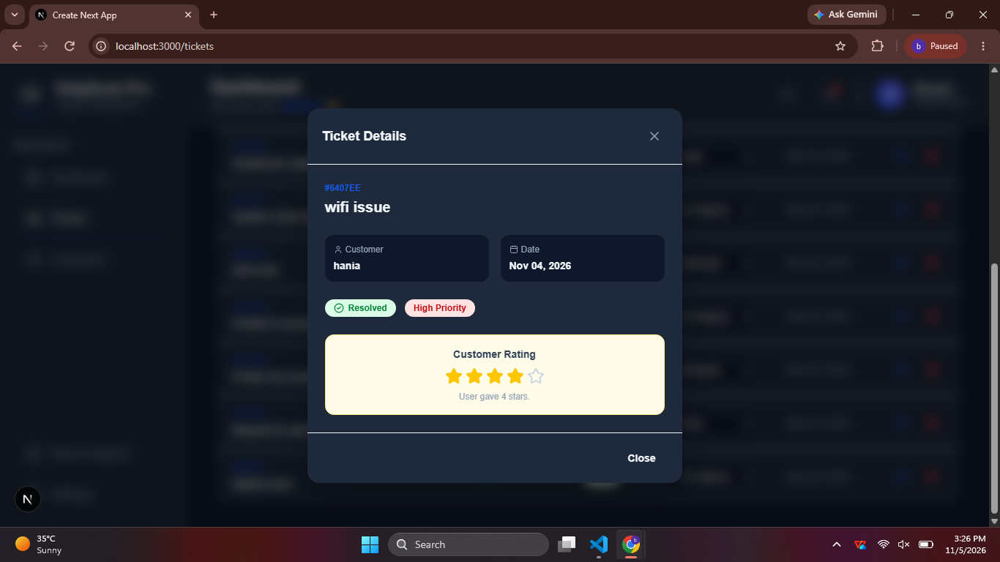
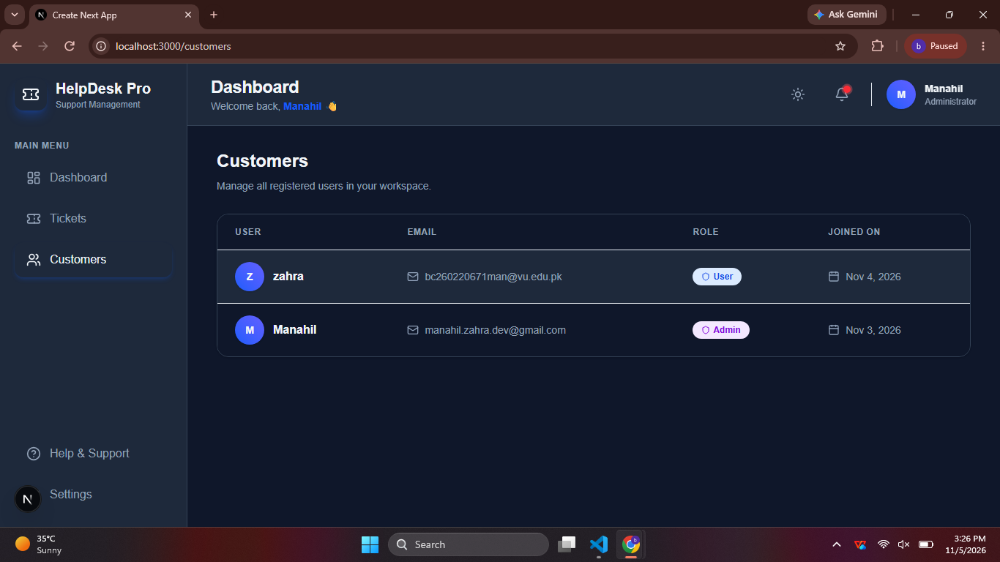

# HelpDesk Pro 🎫
**Smart Complaint & Support Management System**

A full-stack, role-based HelpDesk application built to streamline customer support and ticket management.

## 🚀 Live Demo
[https://helpdeskproj.netlify.app/login](https://helpdeskproj.netlify.app/login)

## ✨ Features
- **Authentication:** Secure Login & Registration with JWT & bcrypt.
- **Role-Based Access Control:** Separate views for Admin and Users.
- **Ticket Management:** Create, View, Update Status, and Delete tickets.
- **Analytics Dashboard:** Interactive Pie Charts and Stats Cards.
- **Customer Feedback:** Users can rate resolved tickets (5-star system).
- **Dark Mode:** Fully responsive premium UI with Light/Dark theme toggle.
- **Search & Filter:** Filter by Status, Priority, and sort High priority first.
- **Settings & Help Pages:** User profile management and FAQs.

## 🛠️ Tech Stack
- **Frontend:** Next.js 16 (App Router), React, TypeScript, Tailwind CSS, Recharts, Lucide Icons.
- **Backend:** Next.js API Routes, Node.js.
- **Database:** MongoDB Atlas, Mongoose.
- **Auth:** JSON Web Tokens (JWT), Bcryptjs.
- **Deployment:** Netlify

## 📸 Screenshots

### 🔐 Authentication



### 📊 Dashboard (Light & Dark Mode)



### 🎫 Ticket Management


### 👁️ Ticket View & Rating Modal


### 👥 Customers Management (Admin Only)


## ⚙️ Installation (Local Setup)
1. Clone the repo: `git clone https://github.com/manahilzahra-dev/helpdesk-pro.git`
2. Install dependencies: `npm install`
3. Create `.env.local` and add:
   ```env
   MONGODB_URI=your_mongodb_uri
   JWT_SECRET=your_secret_key
